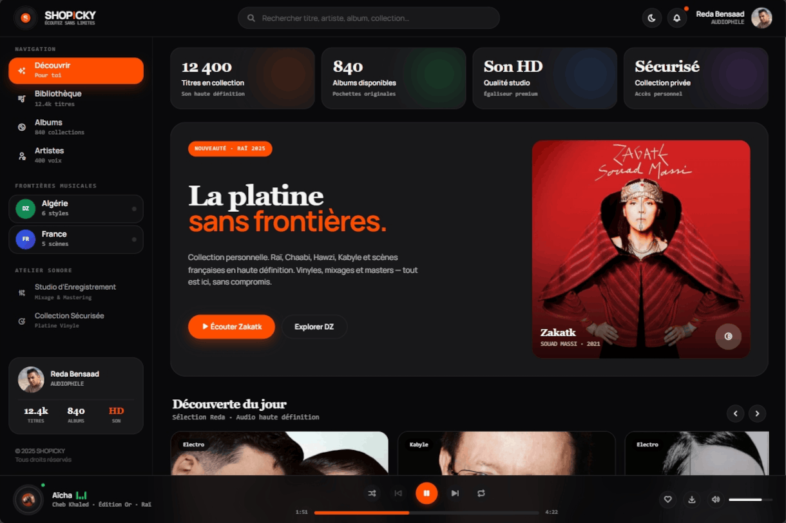

# Shopicky

Music streaming platform combining media management, secure authentication and integrated audio playback.

> \> [Live Preview](https://redabensaad.github.io/shopicky)

---

$ Context

Shopicky is a full-stack music streaming platform designed to manage albums, tracks and audio files through a modern web interface.

The repository follows a monorepo architecture containing both the Spring Boot backend and Angular frontend applications.

---

$ Domain

> \> Music streaming 
> \> Media management 
> \> Audio playback 
> \> Music libraries 
> \> Content administration 

---

$ What Was Built

> \> Music library management 
> \> Album management 
> \> Track management 
> \> Audio file uploads 
> \> Integrated music player 
> \> Playlist-style navigation 
> \> Advanced search and filtering 
> \> JWT authentication workflows 
> \> Role-based access control 
> \> Media streaming experience 

---

$ Technical Stack

> \> Java 17 
> \> Spring Boot 3.2 
> \> Spring Security 6 
> \> JWT Authentication 
> \> MongoDB 
> \> GridFS 
> \> Spring Data MongoDB 
> \> Angular 17 
> \> TypeScript 
> \> NgRx 
> \> RxJS 
> \> Bootstrap 5 
> \> Docker 
> \> Maven 

---

$ Architecture

The application follows a full-stack architecture composed of a Spring Boot backend and an Angular frontend.

Audio files are stored using MongoDB GridFS while authentication and authorization are handled through Spring Security and JWT-based workflows.

The frontend relies on NgRx and RxJS to manage application state, media playback interactions and data synchronization.

---

$ Project Status

> \> Completed project 
> \> Full-stack application 
> \> Monorepo architecture 
> \> Music streaming platform 

---

$ Notes

This project showcases media storage, authentication, state management and modern full-stack application development.

Particular attention was given to audio management, secure content access and frontend-backend integration.

---

$ Preview

---

$ Built

✓ Nov 2025

